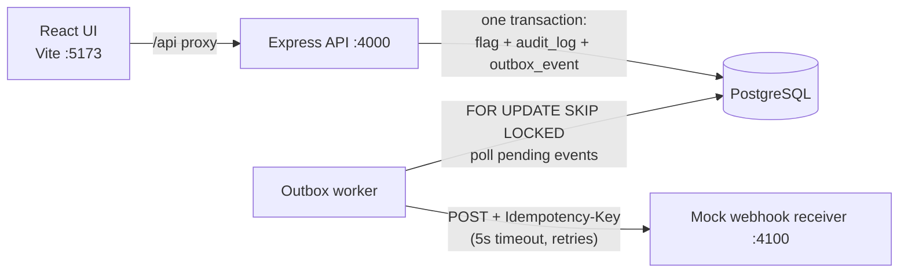

# Team Feature Flags & Audit Log

A small feature-flag dashboard. You can list and filter flags, create them, and switch them on or off.

- Every change writes an **immutable audit entry** in the same database transaction as the change.
- Changing a **prod** flag sends a webhook **asynchronously**, through a transactional outbox.

The repo is also a **local harness**. One command starts everything, and one command checks everything.

## Quick start

Prerequisites: **Docker** (with Compose v2), **Make** and **Git**. No local Node or browsers are needed.

```bash
make dev    # start the whole stack: Postgres, migrations + seed, API, worker, webhook receiver, UI
make test   # lint + typecheck + API integration tests + Playwright E2E, in an isolated stack
```

| What                      | URL                             |
| ------------------------- | ------------------------------- |
| Dashboard                 | http://localhost:5173           |
| API                       | http://localhost:4000/api/flags |
| Webhook receiver (events) | http://localhost:4100/events    |

On the first boot the `migrate` service applies the migrations and seeds 9 flags with some history, so the app is usable right away. The seed is deterministic (fixed ids and timestamps) and only runs on an empty database. `make reset` wipes the data, and the next `make dev` reseeds it.

Prefer one sidebar entry per app (Turborepo TUI)? `make ui` runs the API, worker, webhook receiver and UI on the host with hot reload, keeping only Postgres in Docker (published on `DB_PORT`, default 5433). It needs Node 22 and `pnpm install`.

Other commands: `make help`, `make up` (detached), `make down`, `make logs`, `make lint`, `make typecheck`, `make psql`.
Ports can be changed in `.env` (created from `.env.example` on the first run).

### See the async webhook work

1. Open the dashboard and toggle a **prod** flag. The API responds right away and the activity feed shows the change.
2. Open http://localhost:4100/events. The webhook shows up about a second later, delivered by the worker.
3. Try it with the receiver down: `docker compose stop webhook-receiver`, toggle a prod flag, then `docker compose start webhook-receiver`. The worker retries with backoff and delivers the event once the receiver is back (`make logs` shows the retries).

## Architecture



- **Write path:** the toggle locks the flag row (`FOR UPDATE`), skips no-op changes, and writes the flag, its audit row and, for prod, an outbox event in **one transaction**. No network call happens on the request path.
- **Delivery:** a separate worker sends pending events with a timeout per request, retries with capped exponential backoff, and marks an event `failed` after 5 attempts. Delivery is **at-least-once**; each request carries an `Idempotency-Key`.
- **Enforced by the database:** `UNIQUE (key, environment)`, a `CHECK` on the key format, and a trigger that rejects any `UPDATE` or `DELETE` on `audit_logs`.

The reasoning and the trade-offs behind each of these are in [docs/DECISIONS.md](docs/DECISIONS.md).

## API

| Method | Path                                         | Notes                                                                                         |
| ------ | -------------------------------------------- | --------------------------------------------------------------------------------------------- |
| GET    | `/health`                                    | Liveness + DB check                                                                           |
| GET    | `/api/flags?environment=prod&status=enabled` | Both filters optional                                                                         |
| POST   | `/api/flags`                                 | `{ key, description, environment, enabled? }` → 201 · 400 · **409** duplicate key in that env |
| PATCH  | `/api/flags/:id`                             | `{ enabled: boolean }` → 200 (`meta.changed`) · 400 · 404                                     |
| GET    | `/api/audit-logs?limit=20`                   | Newest first (max 100)                                                                        |

Mutations require an `X-Actor` header (the UI's "Acting as" selector). Errors always look like `{ "error": { "code", "message", "details?" } }`; malformed JSON is a 400 and a body over 100 KB a 413.

## Testing

`make test` runs in a separate Compose project (`ff-test`) with a throwaway tmpfs database and no host ports, so it can run while `make dev` is up. It stops at the first failure.

1. **Lint + typecheck:** ESLint, Prettier, `tsc --noEmit` for every package.
2. **API integration** (`apps/api/test`, Vitest + Supertest against a real Postgres): transactions, 409s (including concurrent creates), the row lock, outbox events for prod only, audit immutability under raw SQL, and the worker's deliver / retry / fail paths.
3. **E2E** (`e2e/`, Playwright in the official image): one journey through the real stack, from filtering and creating flags to toggling a prod flag and **the webhook arriving at the receiver**.

## Project layout

```
apps/api               Express API + outbox worker (same codebase, two entrypoints)
  src/db               Drizzle schema, client, migrate + seed
  drizzle/             generated SQL migrations (0001 = audit immutability trigger)
  src/modules          flags (service = transactions, routes) and audit
  src/outbox           enqueue (in-transaction) and worker (delivery)
  test/                integration tests
apps/web               React + Vite + TanStack Query, Tailwind CSS v4 on light/dark design tokens
apps/webhook-receiver  mock external system
packages/shared        Zod schemas + types shared by the API and the UI
e2e/                   Playwright
```

## Developer experience & guardrails

- **Hot reload:** `tsx watch` for the API, worker and receiver, and Vite HMR for the UI. Source folders are bind-mounted; `node_modules` stays inside the image so the native binaries match Linux.
- **TypeScript strict everywhere** (`noUncheckedIndexedAccess`), plus ESLint and Prettier. The shared Zod contract keeps the API and the UI in sync.
- **`CLAUDE.md`** lists the commands and the invariants AI agents must keep (used while building this repo).

Trade-offs and what I'd do next are in [docs/DECISIONS.md](docs/DECISIONS.md).
